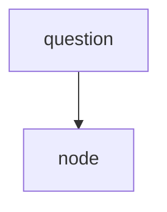

<!--
GUIDE: Only for a system with structure beyond retrieve-then-answer (an agent, a reranker chain, query
rewriting). Documents each node's role, the flow and branches, and the stop conditions.
- Keep it in sync with the code. After implementation, replace the draft diagram with the one generated from the
  code (e.g. a graph library's mermaid export) and list what changed from the draft in section 4.
- Changing the node set needs a reason in PROCESS.md §7: which failure bucket and which question IDs.
- For every node, write who reads its output (docs/steps/07-structure.md).
Keep guide comment in place after filling in.
-->

# System design

## 1. Nodes

| Node | Role | Reads | Output read by |
|---|---|---|---|
| | | | |

## 2. Flow

## 3. Branches and stop conditions

_When each branch is taken; what ends a run and what it returns._

## 4. Changes from the draft

_Nothing yet._
